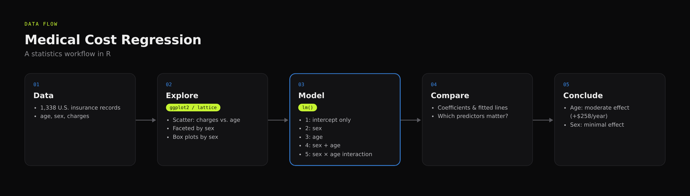
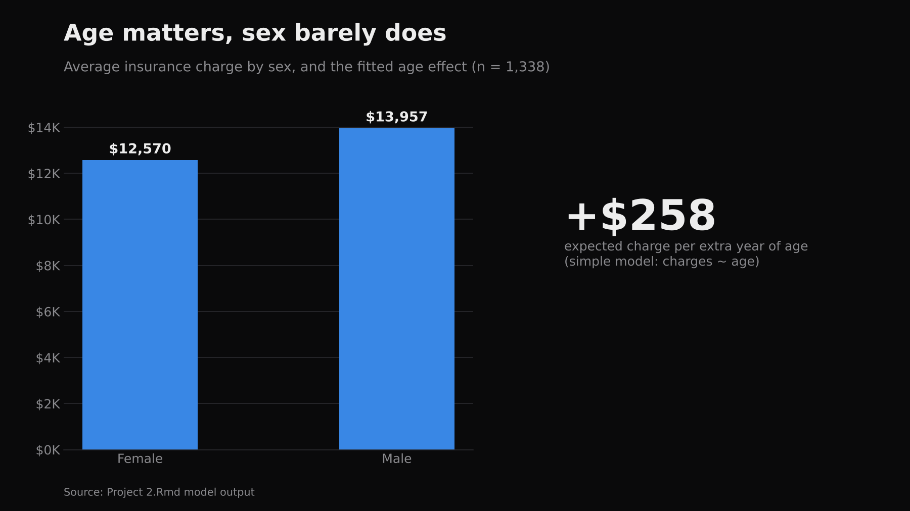
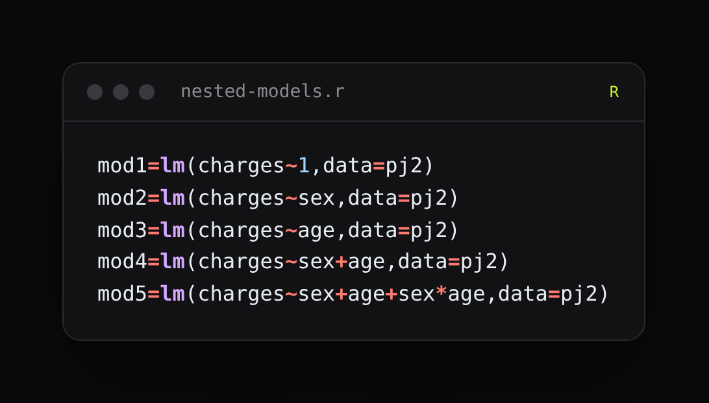
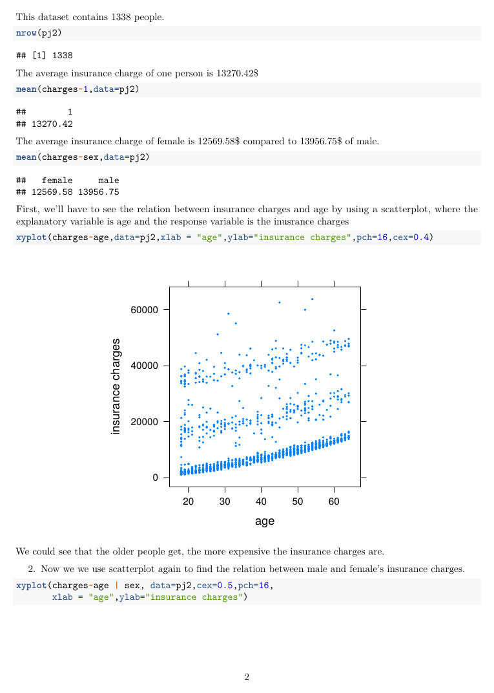
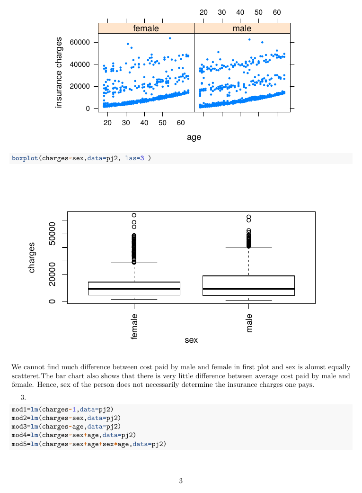

# Medical Cost Regression Analysis (R)

## Introduction
How much do **age** and **sex** explain differences in individual medical insurance charges? This statistics project answers that with linear regression in R on a dataset of 1,338 U.S. insurance records.

## Approach
- Exploratory analysis and visualization with ggplot2
- Five nested linear models compared: intercept only, sex, age, sex + age, and sex × age interaction
- Model comparison and residual diagnostics

## Result
Age is a moderate, significant predictor of charges, while sex has minimal effect once age is accounted for. Most of the variation in charges comes from factors outside these two variables.

## Files
- `Project 2.Rmd`: full R Markdown analysis
- `project2.pdf`: rendered report

## Skills demonstrated
Linear regression · model comparison · statistical inference · ggplot2 · reproducible reporting with R Markdown

## Gallery

**Data flow**

**Insight: summary**

**Code: nested models**

**Report page: page 2**

**Report page: page 3**

